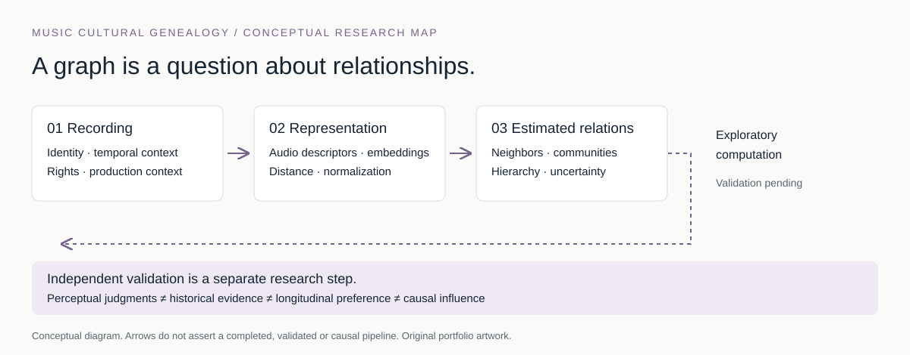
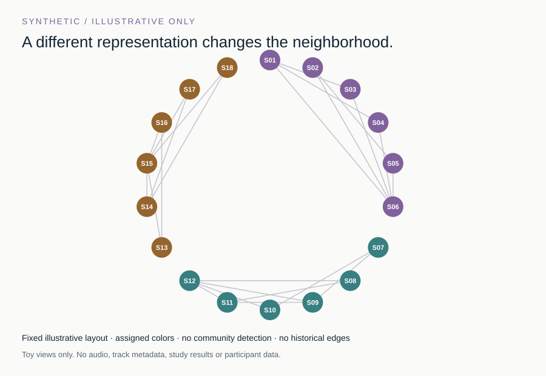

# Music Cultural Genealogy

### Mapping Musical Relationships Beyond Genre Labels

**Research in progress · Computational exploration · Independent perceptual validation pending**

How should we describe relationships between individual recordings when genre labels are too coarse? I developed **Music Cultural Genealogy** as an independent project to investigate audio representations, neighborhood graphs, exploratory communities and the evidence needed to connect computational relationships with how people actually hear music.

The central challenge is measurement: an acoustic neighbor is not automatically a perceptual neighbor, a historical influence or a future favorite. “Genealogy” names a research hypothesis and organizing metaphor; a validated historical family tree has not been established.



**[Research site](https://andrealiuz.github.io/music-cultural-genealogy/site/index.html) · [Offline HTML source](site/offline.html)** · [Research status](RESEARCH_STATUS.md) · [Data and copyright](DATA_AND_COPYRIGHT.md)

## What the work contributes

- A recording-level research question that separates audio representations from independently assessed musical relationships and changing preferences.
- An exploratory engineering line using audio descriptors, neighborhood graphs, Leiden community detection and a separately computed Ward hierarchy.
- A focus on counterexamples, representation sensitivity and the evidence required before a graph can support a cultural or perceptual claim.

### Research methods used in local prototypes

Historical local prototypes built neighborhood graphs from audio descriptors and used Leiden for graph community assignments. Ward clustering produced a separate hierarchy; Leiden labels did not generate that tree. These implemented exploratory methods are different from the small synthetic illustration below, which runs neither algorithm.

These are bounded descriptions of ongoing work. This portfolio contains no original study audio, features, numerical research results or unpublished implementation. It does not claim a new embedding algorithm, recommendation improvement or validated model of cultural descent.

## Explore a safe illustration



The [interactive explorer](https://andrealiuz.github.io/music-cultural-genealogy/site/index.html#explorer) shows how changing a representation weight, neighbor count or similarity threshold changes a graph. Its nodes and features are entirely synthetic. The fixed circular layout is drawn for legibility, not computed from music.

**This demonstration does not run Leiden or Ward. It is not a reproduction of a research experiment.** It uses only a generic weighted cosine score and top-k neighbors. No node corresponds to a real song, artist, listener or culture.

Generate the illustration with Python's standard library, without network access or extra packages:

```sh
python -B demo/build_synthetic_music_graph.py --out demo/generated
python -B tests/test_synthetic_graph.py
```

The command writes only into the requested output folder. It creates a JSON feature set, a JavaScript data wrapper and an SVG preview. To inspect the included page, open `site/offline.html` directly in a browser; no server is required. The bundled page already includes matching generated data.

## Read the research argument

| Question | Note |
|---|---|
| What relationship are we trying to measure? | [Research questions](docs/research_questions.md) |
| What does an audio representation retain or lose? | [Representation pipeline](docs/representation_pipeline.md) |
| How should communities and hierarchies be interpreted? | [Community detection](docs/community_detection.md) |
| What would make a genealogy claim credible? | [Hypothesis and limits](docs/lineage_hypothesis_and_limits.md) |
| What is supported, and what remains to be tested? | [Evidence overview](docs/evidence_overview.md) |

## Contribution and dependencies

The research questions, data collection, computational experiments and interpretation were independently designed and conducted by **@ANDreaLiuz**; no other student or faculty researcher co-developed the project. See [authorship and scope](AUTHORSHIP_AND_SCOPE.md). Historical prototypes use established third-party tools and methods, including OpenL3, librosa, Leiden and Ward clustering; those methods are not claimed as original inventions. The original study implementation remains private pending research and rights review.

The portfolio diagrams and standalone synthetic illustration were newly authored with AI coding assistance for this portfolio. They do not use the research code or study material. The demonstration depends only on Python's standard library and browser-native HTML, CSS and JavaScript; it imports no third-party library.

Research remains in progress; no submission, acceptance or publication is asserted here. No open-source license has been selected for this portfolio.

The GitHub repository and Pages links were checked on 28 October 2026. The offline HTML source is a file view on GitHub; download the repository and open `site/offline.html` to run it locally. Markdown notes remain local files in that edition.
